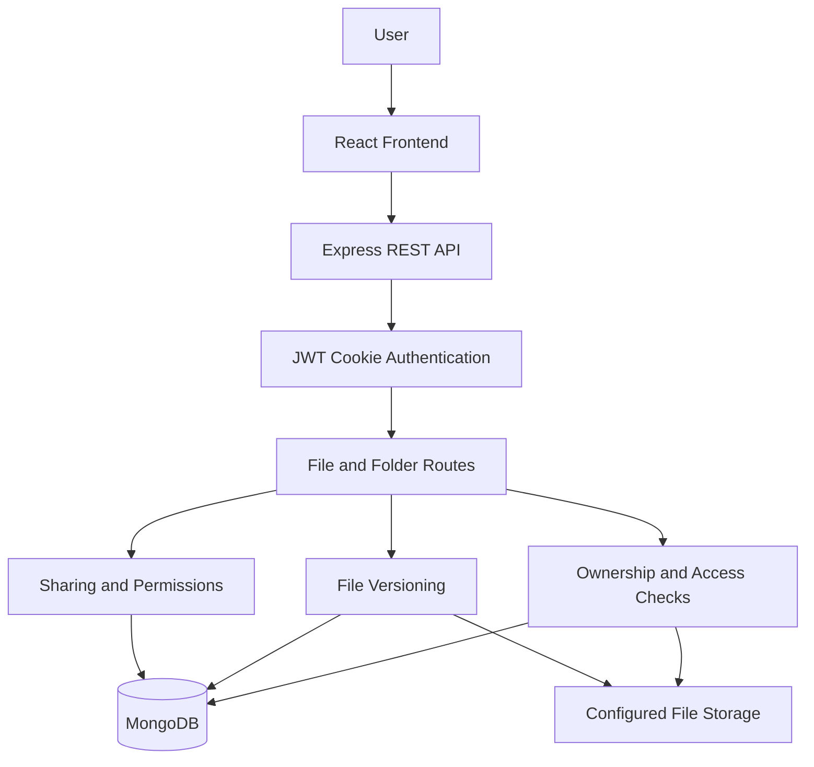
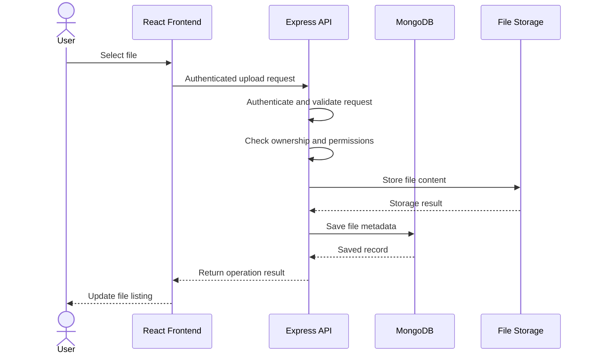
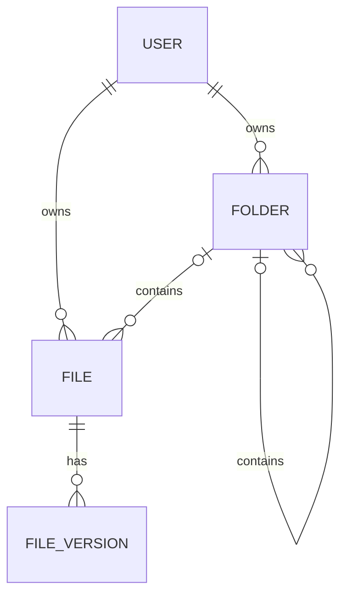

# DriveX Architecture

DriveX is a MERN-stack file management application that enables users to upload, organize, manage, and share files through a secure web interface.

## 📐 High-Level Architecture

## 🛠️ Technology Stack

| Layer | Technology | Responsibility |
|---|---|---|
| Frontend | React.js | User interface and file management |
| Backend | Node.js, Express.js | REST API and business logic |
| Database | MongoDB, Mongoose | Users and resource metadata |
| Authentication | JWT, HTTP-only cookies | Session authentication |
| File Storage | Configured storage provider | Uploaded file contents |

## 🧩 Core Components

### 1. Frontend

The React application provides the interface for:

- Browsing files and nested folders
- Uploading and downloading files
- Renaming and moving resources
- Managing starred items and trash
- Viewing file versions
- Sharing files and folders

### 2. Backend API

The Express server processes client requests and coordinates application operations.

Its responsibilities include:

- Authentication and request validation
- File and folder management
- Ownership and permission checks
- File version management
- Sharing and access control
- Database and storage operations

### 3. Database Layer

MongoDB stores application data through Mongoose models.

The main data entities are:

| Entity | Purpose |
|---|---|
| User | Account and ownership information |
| File | File metadata and associated references |
| Folder | Folder metadata and parent relationships |
| File Version | Information about previous file versions |

The exact schema fields and relationships should be confirmed against the current models.

### 4. File Storage Layer

File contents are stored separately from MongoDB metadata.

The active storage provider and its configuration must be verified in the backend source code before documenting implementation-specific details.

## 🔄 File Upload Data Flow

*The diagram represents the intended flow. Actual execution order and failure handling depend on the implemented upload handler.*

## 🔐 Authentication and Authorization

DriveX uses JWT-based cookie authentication.

- HTTP-only cookies help prevent JavaScript from directly reading session tokens.
- Protected endpoints must authenticate requests.
- Resource operations must enforce ownership.
- Shared resources must respect granted permissions.
- Viewer and Editor restrictions must be enforced by the backend.

Frontend restrictions alone are not sufficient for access control.

## 📁 File and Folder Management

The application supports file and folder operations through the REST API.

Key capabilities include:

- Nested folder organization
- File uploads and downloads
- Rename and move operations
- Trash and restoration
- Permanent deletion
- Starred items
- File version management
- Sharing and access control

## 🗃️ Data Relationships

This is a conceptual relationship diagram, not a verified representation of the exact Mongoose schemas.

## 🛡️ Security and Data Integrity

The architecture should enforce the following safeguards:

- Authenticate protected requests.
- Validate identifiers and user input.
- Verify ownership and sharing permissions.
- Prevent unauthorized file access and unsafe path handling.
- Keep credentials and secrets in environment variables.
- Handle storage and database failures safely.
- Avoid inconsistent metadata when uploads or deletions fail.

## ⚠️ Implementation Notes

This document describes the architecture and intended responsibilities of DriveX. Verify the following against the current source code before treating them as confirmed implementation details:

- Active file storage provider
- Exact Mongoose schemas and relationships
- Authentication middleware behavior
- Viewer and Editor permission enforcement
- File-version storage and restoration
- Upload and deletion failure handling
- Database indexes and validation rules
